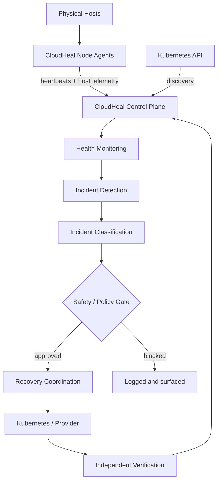

<div align="center">

# ☁️ CloudHeal

### Infrastructure that notices when it breaks, and proves it got better.

**Monitor · Detect · Recover · Verify**

A Kubernetes-native intelligence layer for private clouds: host and workload monitoring, incident detection, safety-gated recovery coordination, and independent verification.

<br/>


</div>

---

## ⚡ The Idea in 30 Seconds

Kubernetes is excellent at replacing failed pods. But when a node drops off the network, operators still need answers:

> *What failed? Why? Was it safe to act? **Did recovery actually work?***

**CloudHeal answers those questions.** It does not compete with Kubernetes. It extends it with infrastructure-independent monitoring, incident management, safety policies, and verification.

| Kubernetes handles | CloudHeal adds |
|---|---|
| Scheduling & pod lifecycle | Physical-host visibility through Node Agents |
| Deployment reconciliation & replicas | Incident detection, classification & durable history |
| Service discovery & networking | Policy and safety evaluation before any action |
| Native workload replacement | **Independent verification that recovery really succeeded** |

> **Architecture principle:** Kubernetes remains the authoritative orchestration system. CloudHeal never rebuilds the scheduler, reconciliation loop, or replica management.

---

## ✨ Highlights

- 🫀 **Node Agents** report CPU, memory, disk, OS, runtime and network info, plus heartbeats, from physical hosts (including Windows)
- ☸️ **Kubernetes discovery** of nodes, namespaces, pods, deployments and services, with safe partial-failure handling
- 🚨 **Incident detection & persistence** backed by SQLite
- 🛡️ **Deterministic safety gate**: recovery targets are validated and actions authorized before anything runs
- ✅ **Independent verification**: a successful API call is not proof the app is healthy
- 🔬 **Separated health signals**: host connected, K3s joined, node Ready, node validated and workload healthy are never collapsed into one status
- 🧠 **AI is optional**: the system works fully with no LLM available
- 🔒 **Automatic recovery is OFF by default**

---

## 🏗️ Architecture



### Three layers, clear responsibilities

<table>
<tr>
<td width="33%" valign="top">

#### 🧭 Control Plane
*Python · FastAPI · SQLite*

- Node registration & validation
- Heartbeat processing
- Kubernetes integration & discovery
- Workload inspection
- Incident detection & persistence
- Recovery coordination & verification
- Background monitoring

</td>
<td width="33%" valign="top">

#### 🤖 Node Agent
*Python · cross-platform*

- Host identity
- CPU, memory & disk info
- OS & runtime discovery
- Network & Tailscale address discovery
- Registration & heartbeats

*Reports the physical host. It does not join the machine to Kubernetes.*

</td>
<td width="33%" valign="top">

#### ☸️ Kubernetes / K3s
*The orchestration foundation*

- Container lifecycle
- Pod scheduling
- Deployment reconciliation
- Replica management
- Service networking
- Workload replacement & rescheduling

</td>
</tr>
</table>

### 🔬 Five signals, never one

A machine can be registered with CloudHeal without joining Kubernetes, and a Kubernetes node can exist without a CloudHeal agent. So CloudHeal tracks them separately:

| Signal | Meaning |
|---|---|
| CloudHeal Node Agent connected | The physical machine can talk to CloudHeal |
| K3s Agent connected | The machine's Kubernetes environment joined the cluster |
| Kubernetes Node `Ready` | Kubernetes considers the node healthy |
| CloudHeal node validated | CloudHeal's additional checks passed |
| Workload healthy | The application passed its health checks |

---

## 🧪 The Test Bed: A Real Three-Laptop Private Cloud

CloudHeal is built and tested on a **real multi-machine K3s cluster connected over Tailscale**, not a single-box simulation.

| Machine | Role | Environment |
|---|---|---|
| 🍎 MacBook | K3s server + CloudHeal Control Plane | macOS, K3s in a Multipass Ubuntu VM |
| 🪟 Windows laptop 1 | Kubernetes worker | Ubuntu on WSL2 |
| 🪟 Windows laptop 2 (Lenovo) | Kubernetes worker | Ubuntu on WSL2 |

The three-machine topology is configured and both workers have joined the cluster. Coordinated three-device validation is the current focus.

### 🎬 Demonstrated: Kubernetes-native worker failover

A video-streaming website runs inside the cluster, exposed privately through **Traefik** over Tailscale.

```text
 1. Website deployed on the worker (nginx, ConfigMap + Deployment + Service + Ingress)
 2. Website reachable over the private network
 3. Worker's K3s agent stopped  ->  simulated node failure
 4. Kubernetes marks the node NotReady
 5. Kubernetes creates a replacement Pod on the Mac node
 6. Service endpoint updates automatically
 7. curl returns HTTP/1.1 200 OK
```

> **Honest by design:** Kubernetes performed the replacement. CloudHeal automatic recovery was disabled during this test. CloudHeal's own incident detection and persistence for this failure are the next items being verified, because CloudHeal never claims credit for a recovery Kubernetes performed on its own.

---

## 🛡️ Safety Principles

1. **Kubernetes-native.** Use the Kubernetes API; never reinvent orchestration.
2. **Infrastructure-independent.** K3s is the first target, but standard Kubernetes interfaces are preferred over K3s-specific behavior.
3. **Deterministic safety before AI autonomy.** AI must never bypass policy, target validation or authorization.
4. **Observation and mutation stay separate.** Read-only discovery, workload mutation and incident recovery are distinct paths.
5. **Verify, don't assume.** An incident resolves only after verification succeeds.
6. **Evidence over demos.** Production readiness is established by evidence, not by successful demonstrations.

**GKE** serves as CloudHeal's primary operational reference for node health, auto-repair, failure detection, workload protection and auditability, adapted to private-cloud realities.

---

## ✅ Validation Status

| Area | Status |
|---|---|
| Kubernetes discovery safety (empty-selector guard) | ✅ Tested |
| Partial discovery with per-category errors | ✅ Tested |
| Windows Node Agent portability | ✅ Tested |
| Automated suites (previously reported) | ✅ Control Plane 157 · Node Agent 14 · E2E 9 |
| Live Deployment + Service lifecycle on K3s | ✅ Passed |
| Windows host registered with CloudHeal | ✅ Passed |
| Windows WSL2 worker joined K3s | ✅ Passed |
| Kubernetes-native failover + HTTP 200 | ✅ Demonstrated |
| Three-device coordinated validation | 🚧 In progress |
| CloudHeal incident detection & persistence on live failure | 🔎 Being verified |
| Cross-node Pod networking on all workers | 📋 Pending |
| CloudHeal manual & automatic recovery | 📋 Pending (auto disabled) |
| Least-privilege Kubernetes access | 📋 Pending |
| Production readiness | ⛔ Not yet established |

---

## 🗺️ Roadmap

| Phase | Focus | Status |
|---|---|---|
| 1 | Control Plane & Node Agent foundations | ✅ Done |
| 2 | Kubernetes integration & workload lifecycle | ✅ Done |
| 3 | Repeatability & E2E testing | ✅ Complete |
| 4 | Kubernetes-backed private-cloud foundation | 🚧 In progress |
| 5 | Incident & recovery validation | ⏭️ Next |
| 6 | Multi-laptop private cloud | 🚧 Onboarded, validation pending |
| 7 | Node Agent integration | 🚧 Partially validated |
| 8 | Least-privilege Kubernetes security (RBAC) | 📋 Planned |
| 9 | Recovery safety & failure-mode testing | 📋 Planned |
| 10 | Control Plane operational reliability | 📋 Planned |
| 11 | Production readiness | 📋 Planned |
| 12 | AI-assisted incident diagnosis | 🔮 Deferred |
| 13 | Multi-provider infrastructure support | 🔮 Deferred |

---

## 🛠️ Tech Stack

| Layer | Technology |
|---|---|
| Language | Python |
| API | FastAPI / Starlette |
| Orchestration | Kubernetes (K3s), Kubernetes Python client |
| Runtime | containerd |
| Ingress | Traefik |
| Persistence | SQLite |
| Networking | Tailscale |
| Dev environment | macOS, Multipass, WSL2 |
| Testing & tooling | pytest, uv, Git, GitHub |

---

## 🚀 Getting Started

```bash
git clone https://github.com/anikettt-cd/CloudHeal.git
cd CloudHeal

uv sync          # install the environment
uv run pytest    # run the tests
```

Point a Node Agent at a Control Plane with:

```bash
export CLOUDHEAL_CONTROL_PLANE_URL="http://<control-plane-tailscale-ip>:9000"
uv run --package cloudheal-node-agent cloudheal-node-agent
```

Useful Control Plane settings:

| Variable | Purpose |
|---|---|
| `CLOUDHEAL_DB_PATH` | SQLite database location |
| `CLOUDHEAL_MONITOR_TARGETS` | Workloads to monitor, e.g. `namespace/deployment` |
| `CLOUDHEAL_MONITOR_INTERVAL_SECONDS` | Monitoring interval |
| `CLOUDHEAL_AUTO_RECOVERY_ENABLED` | Keep `false` unless you explicitly intend otherwise |

> A complete standalone deployment guide is still in progress.

---

## 🔮 Where This Is Going

Not just restarting failed workloads, but infrastructure that can **understand** failures, **coordinate** safe recovery, and **verify** that services returned to health: advanced observability, incident correlation, policy-driven recovery, node lifecycle management, provider adapters, and optional AI-assisted diagnosis, all subordinate to deterministic safeguards.

---

## 👨‍💻 Author

**Aniket Saini**: IT Engineering student · Backend & Applied AI Engineering

[](https://github.com/anikettt-cd)

---

<div align="center">

**CloudHeal: Building Infrastructure That Can Recover.**

<sub>Designed for resilience · Built around Kubernetes · Evolving toward intelligent infrastructure operations</sub>

</div>
